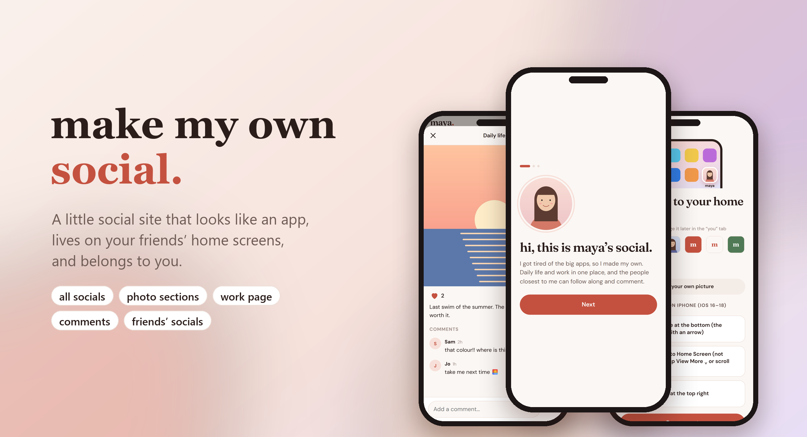
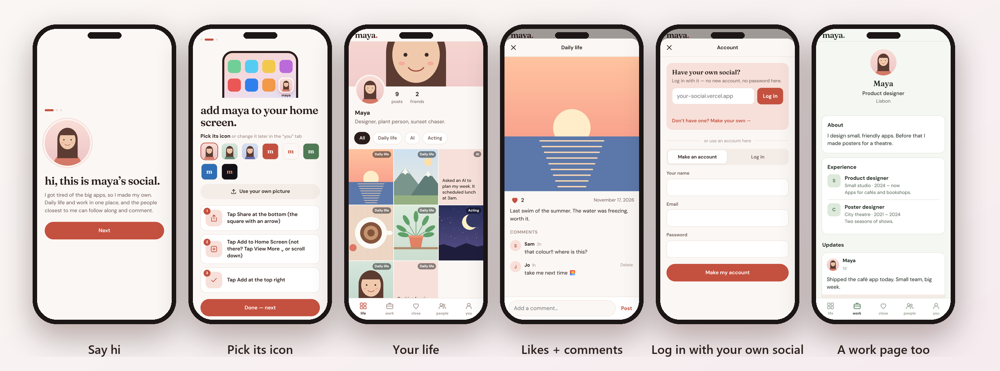

  

  
  &nbsp;
  <a href="https://evys-social.vercel.app"><b>See Evy's →</b></a>

## Social media is about to change

For twenty years, posting meant renting space on someone else's app. They
chose the layout, ran the feed, kept your photos and your friends list, and
could change the rules any day.

AI changes that. Building an app used to take a team; now you can describe
the one you want to Claude and have it online in an afternoon. When everyone
can make their own, there's no reason for everyone to share one company's app.

So the next socials will be:

- **Yours** — your own site, your own address, your photos in your own storage
- **Fully customizable** — your sections, colours, pages and icon, changed
  whenever you like by asking Claude
- **Decentralized** — no central app. Each site publishes a small public card
  (`/social.json`), sites link to each other in a People tab, and you can log
  in to a friend's site with your own instead of making an account

This repo is a working start: a social site that looks and feels like a phone
app, lives on your friends' home screens, and connects to everyone else's.
Make yours, add your friends, and you're part of the network.

  

## What you get

- 🌐 **All socials** — one timeline of your posts, with your Instagram connected through [Composio](https://composio.dev)
- 📣 **Post everywhere** — send a post to Instagram and LinkedIn from the app
- 📸 **My social** — a photo grid you sort into your own sections (Evy's are Daily life, AI, Acting)
- 💼 **Work** — a simple LinkedIn-style page: headline, about, experience, updates
- 💬 **Comments & likes** — friends make an account, or log in with their own social
- 👋 **People** — cards for your friends' socials; tap one to visit
- 📱 **On their home screen** — a three-step intro with an icon picker, like a real app

## Make yours with Claude (easiest)

On a computer, click **Open in Claude** above. It opens a Claude Code session
in the [Claude desktop app](https://claude.ai/download) with the instructions
ready; press Enter and it walks you through everything: your photos, your
sections, your colours, putting it online for free.

Prefer to do it by hand? Give Claude [`skill.md`](skill.md) and say
"make me my own social", or follow the steps below.

## Or do it yourself

1. Make a free [Supabase](https://supabase.com) project and run
   `supabase/setup.sql` in its SQL editor.
2. Click **Deploy with Vercel** above and paste your Supabase URL and anon key
   when it asks.
3. In your new GitHub copy, edit `config.js` (name, handle, bio, intro, work)
   and put your photos in `selfies/`. Vercel redeploys on every change.
   Run `python tools/make-icons.py` if you can, so Android gets your icons.
4. For "log in with your own social": deploy `supabase/functions/site-login`
   and set its secret `SITE_ORIGIN` to your site's address.
5. Supabase → Authentication → URL configuration → Site URL = your address.
6. Sign up on your site, then run the last line of `setup.sql` with your email
   to make yourself the owner.

## How sites connect

- `/social.json` is each site's public card (name, photo, bio, latest public
  posts). The People tab reads it.
- "Log in with your own social": site A sends you to your site B, B asks you
  to confirm, then hands A a one-time code that only works for A, once, for two
  minutes. A checks it with B and logs you in as "you · B". No passwords move
  between sites.

Free Supabase projects pause after about a week with no visits; open the
dashboard to wake it.
